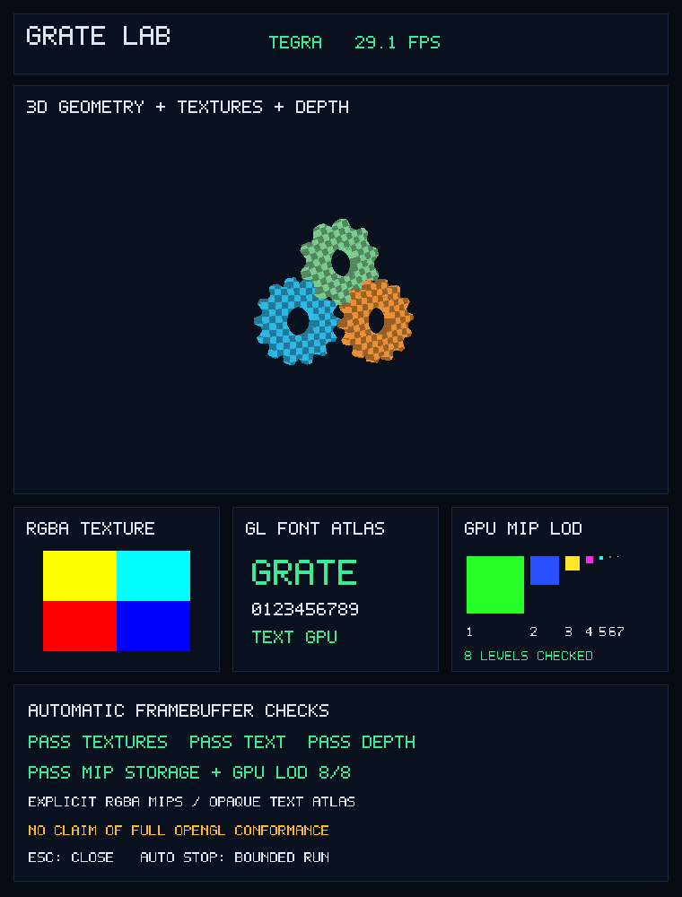

# GRATE Lab: textured gears, text and mipmaps



This standalone GLX/OpenGL 2.1 application shows three rotating textured gears, an OpenGL font atlas, depth occlusion and a color-coded mipmap chain. The renderer and live FPS are visible. Escape closes the window; the supplied launcher uses a bounded run.

Before animation, the application checks its actual framebuffer:

- A four-quadrant RGBA texture: 10,816 pixels, including orientation and channel order.
- Opaque text from a GL texture atlas: 175 foreground/background samples.
- Near/far Z-buffer occlusion: two samples with deliberately reversed draw order.
- Eight distinct uploaded mip levels, checked in full through `glGetTexImage`, followed by eight GPU draw/readback checks. A texture footprint shrinking from 128×128 to 1×1 must select the corresponding uniquely colored level through implicit LOD.

The combined framebuffer checks cover 11,001 samples. The animation starts only after they pass. The gear textures also carry explicitly generated mip chains. This covers the named rendering paths, not all OpenGL functions or full conformance. Text is an opaque RGBA atlas; alpha-blended text, `glBitmap`, automatic `glGenerateMipmap`, arbitrary shaders and a new per-pixel lighting implementation are not claimed.

## Build and run privately

Set `CC` to the target compiler executable, then pass its sysroot, Mesa/X11 include paths and link search paths as arguments to `build.sh`. The application links `-lGL -lX11 -lm`; it has no GLUT or asset-file dependency. For example, with native target development packages:

```sh
CC=cc ./build.sh
```

Use the private Mesa prefix and the backup, deadline and independent kernel-fault monitoring workflow described in the parent README. The application requires the restricted nearest-mipmap sampler patch in this branch. It supports:

```sh
./grate-lab --self-test
./grate-lab --test mipmap
./grate-lab --seconds 10 --capture frame.ppm
```

A private installation can put the executable at `PREFIX/bin/grate-lab`, keep `run` separately, and write the absolute private prefix to a `prefix-path` file next to `run`. Alternatively, set `GRATE_LAB_PREFIX`. The launcher verifies that `glxinfo -B` reports Tegra before selecting hardware mode:

```sh
./run
./run --seconds 10
./run --software --seconds 10
```

The default run lasts 20 seconds and has an outer 35-second deadline. `--software` explicitly selects private softpipe as a reference. The renderer printed by the application remains authoritative. Per-process library overrides do not change system Mesa, Xorg, the desktop, the kernel or autostart settings. The launcher deadline complements the separate privileged kernel watcher used during device validation; it does not itself monitor kernel faults.

## Recorded validation

On Nexus 7 grouper E1565, ARMv7 musl, Linux 7.0.1-postmarketos-grate and Xorg/OpenTegra, each individual check, the combined self-test and the animation passed under both private softpipe and Tegra: 12 bounded runs in total. The hardware mip test emitted eight GR3D class `0x60` draws, and all eight LOD colors were correct. No new kernel faults occurred and all 149 protected system files and the complete recorded manifest remained unchanged. A separate launcher check also passed.

One quiet animation interval, including one framebuffer capture, measured:

| Renderer | Frames | Interval | Average FPS |
|---|---:|---:|---:|
| Tegra / GRATE | 149 | 6.025 s | 24.730 |
| softpipe | 5 | 6.342 s | 0.788 |

These are short diagnostic measurements with uncontrolled clocks and temperature, not a general performance guarantee. The screenshot's instantaneous FPS can differ from the interval average.
